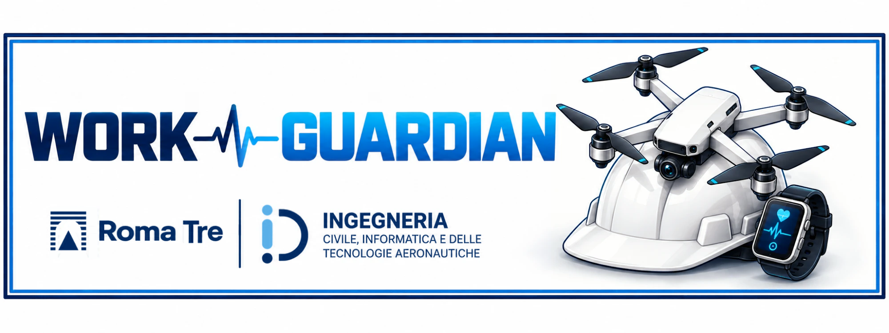
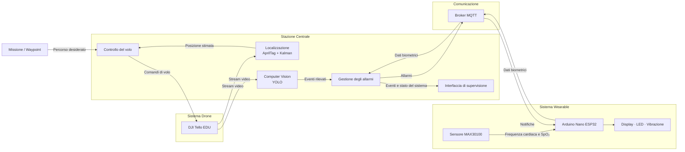

<p align="center">
  
</p>

# Work-Guardian

**Work-Guardian** è un **Cyber-Physical-Human System (CPHS)** progettato per supportare la sicurezza nei cantieri con lavorazioni in quota.

Il sistema integra un **drone DJI Tello EDU**, uno **smartwatch biometrico** basato su Arduino Nano ESP32 e una **stazione centrale di supervisione**. Attraverso computer vision, monitoraggio biometrico e comunicazione MQTT, Work-Guardian consente di monitorare l'ambiente di lavoro e l'operatore, rilevare condizioni potenzialmente pericolose e generare segnalazioni in tempo reale.

Progetto sviluppato per il corso di **Cyber Physical Systems** dell'**Università degli Studi Roma Tre**, A.A. 2025/2026.

## Funzionalità principali

Work-Guardian integra le seguenti funzionalità:

- navigazione autonoma del drone lungo un percorso definito tramite waypoint;
- localizzazione mediante marker **AprilTag** e stabilizzazione della posizione tramite **filtro di Kalman**;
- acquisizione e analisi delle immagini provenienti dalla camera del drone;
- rilevamento tramite modelli **YOLO** dei dispositivi di protezione individuale;
- verifica della presenza delle reti di sicurezza;
- rilevamento dell'ingresso in aree interdette;
- rilevamento delle cadute;
- monitoraggio di frequenza cardiaca e SpO₂ tramite smartwatch biometrico;
- comunicazione bidirezionale tra smartwatch e stazione centrale mediante **MQTT**;
- visualizzazione e gestione degli allarmi in tempo reale.

## Architettura del sistema



L'architettura di Work-Guardian è organizzata in quattro sottosistemi principali: **drone**, **stazione centrale**, **infrastruttura di comunicazione** e **sistema wearable**.

Il **DJI Tello EDU** costituisce la piattaforma mobile del sistema. Acquisisce le immagini dell'ambiente e riceve dalla stazione centrale i comandi necessari alla navigazione lungo il percorso definito.

La **stazione centrale** rappresenta il principale nodo di elaborazione. Gestisce il controllo del volo, la localizzazione del drone mediante AprilTag e filtro di Kalman, l'analisi delle immagini tramite modelli YOLO e la gestione degli eventi e degli allarmi generati durante il monitoraggio.

La comunicazione tra stazione centrale e smartwatch avviene tramite un **broker MQTT**, utilizzato per lo scambio dei dati biometrici e delle notifiche di allarme.

Lo **smartwatch biometrico**, basato su Arduino Nano ESP32 e sensore MAX30100, acquisisce i parametri fisiologici dell'operatore, come frequenza cardiaca e SpO₂, e riceve le segnalazioni destinate all'operatore, presentandole tramite display, LED e vibrazione.

Nel complesso, il sistema integra **percezione ambientale, monitoraggio biometrico, comunicazione e supervisione** all'interno di un'unica architettura Cyber-Physical-Human.

## Componenti principali

| Componente | Funzione |
| --- | --- |
| **DJI Tello EDU** | Navigazione lungo il percorso e acquisizione delle immagini dell'area di lavoro |
| **Stazione centrale** | Controllo del drone, localizzazione, computer vision e gestione degli allarmi |
| **Smartwatch biometrico** | Monitoraggio dei parametri fisiologici e segnalazione degli allarmi all'operatore |
| **Arduino Nano ESP32** | Unità di elaborazione e comunicazione dello smartwatch |
| **MAX30100** | Misura della frequenza cardiaca e della SpO₂ |
| **YOLO** | Rilevamento degli elementi e delle condizioni di interesse nelle immagini |
| **AprilTag** | Supporto alla localizzazione del drone |
| **Mosquitto / MQTT** | Comunicazione tra stazione centrale e smartwatch |

## Struttura della repository

```text
work-guardian-cps-dicita/
├── assets/                 # Risorse utilizzate dalla documentazione
├── communication/          # Configurazione della rete e del broker MQTT
├── drone/                  # Applicazione principale e gestione del drone
├── vision/                 # Computer vision, modelli YOLO, training e test
├── wearable/               # Firmware e documentazione dello smartwatch
├── requirements.txt        # Dipendenze Python
└── README.md
```

Le diverse sezioni del progetto sono organizzate in moduli separati per distinguere la gestione del drone, la visione artificiale, la comunicazione e il sistema wearable.

## Requisiti

### Hardware

Per utilizzare tutte le funzionalità del sistema sono necessari:

- DJI Tello EDU;
- computer utilizzato come stazione centrale;
- controller PS4;
- Arduino Nano ESP32;
- sensore MAX30100;
- componenti dello smartwatch;
- infrastruttura di rete necessaria alla comunicazione MQTT.

### Software

Il progetto utilizza principalmente **Python** per la gestione del drone, la visione artificiale, l'elaborazione dei dati e la comunicazione.

Tra le principali dipendenze:

- `djitellopy`
- `pygame-ce`
- `opencv-contrib-python`
- `pyapriltags`
- `numpy`
- `Pillow`
- `ultralytics`
- `torch`
- `torchvision`
- `supervision`
- `PyYAML`
- `pandas`
- `matplotlib`
- `openpyxl`
- `paho-mqtt`
- `pytest`

L'elenco completo, con gli eventuali vincoli di versione, è disponibile nel file `requirements.txt`.

## Installazione

Clonare la repository:

```bash
git clone https://github.com/faiellaemanuele/work-guardian-cps-dicita.git
cd work-guardian-cps-dicita
```

Installare le dipendenze Python:

```bash
pip install -r requirements.txt
```

## Configurazione della comunicazione

Prima di utilizzare le funzionalità che richiedono lo smartwatch è necessario configurare la rete e il broker MQTT.

La procedura è descritta in:

```text
communication/docs/communication_setup.md
```

## Avvio

Una volta completata la configurazione, avviare l'applicazione principale dalla directory principale della repository:

```bash
python drone/main.py
```

Il **DJI Tello EDU** deve essere collegato alla stazione centrale tramite la propria rete Wi-Fi. Il **controller PS4** è necessario per le funzionalità di controllo previste dall'applicazione.

Le funzionalità biometriche e la ricezione delle notifiche sullo smartwatch richiedono inoltre che il **broker MQTT** e il **sistema wearable** siano attivi e correttamente configurati.

## Autori

- Michele Arietta
- Aurora Camusi
- Antonio Di Sabatino
- Emanuele Faiella Lauricella
- Riccardo Magnanelli
- Federico Pace
- Eleonora Ramunno

## Nota

Work-Guardian è un **prototipo accademico** sviluppato a fini didattici e sperimentali.

Il sistema non costituisce un dispositivo di sicurezza certificato e non deve essere utilizzato come sostituto dei sistemi, delle procedure e dei dispositivi di sicurezza previsti dalla normativa applicabile.
